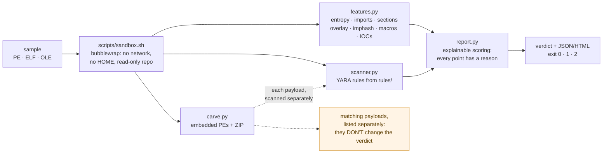
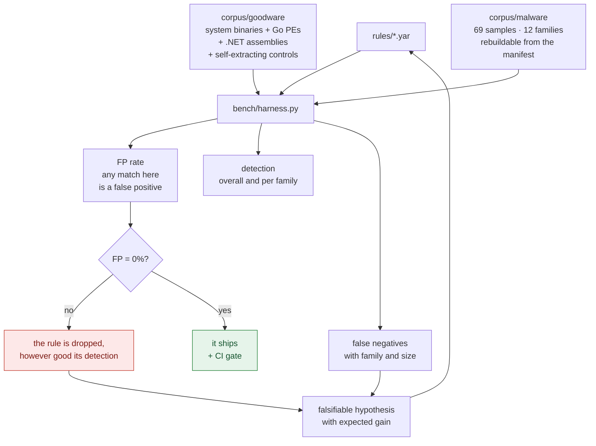

# Crisol: static malware triage engine + YARA rule test bench

*[Versión en español](README.es.md)*

> Analyzes binaries (PE / ELF / Office documents) **without running them**,
> scores them with explainable heuristics and custom YARA rules and, above
> all, **measures how good those rules are** against goodware and malware
> corpora. Detection engineering, not a black box.

[](https://github.com/jorgeress/crisol/actions/workflows/ci.yml)

[](LICENSE)

*A crucible (Spanish: crisol) is where metal is melted down to assay it: it
doesn't make anything, it only reveals what can't stand the test. What gets
assayed here is YARA rules, and more than one hasn't come out in one piece.*

## Why this project

Anyone can run `yara rules.yar sample.exe`. What sets an analyst apart is
knowing **how good a rule is**: how many false positives does it raise
against legitimate software? What is its real detection rate? This project
turns that question into a reproducible number.

A real example from this repo's baseline: a **legitimate, Microsoft-signed**
binary classified as malicious by rules that were too loose:

```
$ crisol scan winhttp-proxy-shim.exe
  verdict  malicious-likely  (score 75/100)      <-- FALSE POSITIVE
  YARA: dynamic_api_resolution_and_alloc, anti_debug_checks
```

### Metric-driven tuning (before → after)

The harness measured the false positive rate on 52 legitimate binaries and
drove the redesign of each rule. Every change is backed by data:

| Rule | FP before | FP after | What changed (and why) |
|------|:--------:|:-------:|------------------------|
| `anti_debug_checks` → `anti_debug_stacked` | **12.2%** | **0%** | A single API (`IsDebuggerPresent` from the CRT) is everywhere. APIs are split into *strong* (NT-level, rare in goodware) and *ubiquitous*, and the rule requires 2 strong or 1 strong + 2 ubiquitous. |
| `dynamic_api_resolution_and_alloc` → `..._small_iat` | **4.5%** | **0%** | `LoadLibrary` + `GetProcAddress` is normal in large software (IATs of 100-258 functions). Real loaders have a **tiny** IAT, so `number_of_imported_functions < 30` is added. |
| `vba_powershell_invocation` | **0.6%** | **0%** | It fired on PEs where `"powershell"` legitimately appears. It now excludes native PE/ELF binaries. |
| **Overall** | **12.18%** | **0.0%** | 52 goodware samples, 0 flagged. |

### The other side of the bench: real detection

Rules that never fire also have a 0% FP rate, so the number above means
nothing on its own. Against **69 real samples from MalwareBazaar**
(12 families) and 315 goodware binaries (247 of them real Microsoft binaries):

| Metric | Value |
|---|---|
| False positives (315 goodware) | **0.0%** |
| Detection (69 real samples) | **33.33%** |

The road to that number wasn't straight: it reached 28.99%, **dropped** to
17.39% when round 3 showed that 8 of those hits were bogus, and round 4 raised
it with rules that actually detect what they claim to. Five post-mortems, and
they all say the same thing: **the bench is only as good as its goodware
corpus.**

- **[Round 1](docs/en/round-1-detection.md)** (19 samples).
  `dynamic_api_resolution_small_iat`, the rule that cut FPs the most in the
  table above, has **0 true positives**. The `IAT < 30` threshold was tuned by
  looking at goodware only; real malware imports between 39 and 658 functions.
  Textbook overfitting, measured and documented.
- **[Recursive scanning](docs/en/recursive-scanning.md)**: opening containers
  pushed detection to 37.68%, and that number **never made it into the
  table**: the 6 new detections came from `high_entropy_section` firing on
  embedded .NET assemblies, and without .NET goodware there was no way to
  falsify them. Round 3 did: they were false positives.
- **[Round 2](docs/en/round-2-rules.md)** (69 samples). Of the three
  hypotheses left by round 1, one ships (+5 detections without touching the
  0% FP rate), one is **refuted** and one is declared **blocked**. The
  "crypter cluster" that was supposed to be the biggest win turned out to be
  **the Go runtime**: the rule that catches it flags `fmt.Println("hello")`
  compiled for Windows, and it flagged **5 out of 5** legitimate Go binaries
  as soon as they were added to the corpus. It would have scored 0% FP against
  the round 1 corpus, which didn't have a single one.
- **[Round 3](docs/en/round-3-dotnet.md)** (.NET goodware). The rule that
  detected the most, `high_entropy_section`, flags a legitimate .NET app with
  images as soon as one is in the corpus. Looking at its hits, **8 out of 10
  were .NET assemblies firing only because of their resources**, just like the
  legitimate ones. It had shipped on day one, with 0% FP. Once fixed,
  detection drops from 28.99% to 17.39% and the +6 from recursive scanning
  disappears.
- **[Round 4](docs/en/round-4-dotnet-loader.md)** (315 goodware). Four
  "families" (njrat, MassLogger, RemcosRAT, Formbook) are **the same
  crypter**: a decoy WinForms app with the payload hidden in the pixels of an
  image. Two candidate rules scored 8 TP and 0 FP against 247 Microsoft
  binaries and fell to two purpose-built controls (a dropper with a background
  image). The one that survives, plus an njRAT signature, brings detection up
  to **33.33%**. Along the way, `anti_debug_stacked` turned out to flag the
  .NET debugger.

Raw metrics are versioned in [`bench/metrics-2026-09-23-ronda4.json`](bench/metrics-2026-09-23-ronda4.json)
(and earlier rounds: [round 3](bench/metrics-2026-09-23-ronda3.json),
[`2026-09-07`](bench/metrics-2026-09-07.json) and
[`2026-09-03`](bench/metrics-2026-09-03.json)).
The malware corpus can be rebuilt from
[`bench/corpus_manifest.json`](bench/corpus_manifest.json) (sha256 and family;
samples are not redistributed), and the Windows goodware with
[`make_goodware_go.sh`](bench/make_goodware_go.sh) and
[`make_goodware_dotnet.sh`](bench/make_goodware_dotnet.sh).

## Architecture

### How a sample is analyzed

Nothing is executed: it's all reading bytes, and inside a sandbox on top of
that.



### How a rule is measured

This is what sets the project apart. A rule isn't worth what it catches, but
what it catches **without flagging legitimate software**, and that is a
number.



The loop on the right is the real work: false negatives are the to-do list
for the next round of rules, and the acceptance criterion is not up for
negotiation. The four rounds done so far are documented in
[`docs/en/`](docs/en/), including the one that ended up **throwing out** the
most promising rule and the one that took 8 hits away from the rule that
detected the most.

| Module | What it does |
|--------|--------------|
| `src/crisol/features.py` | Static extraction: hashes, global/per-section entropy, imports (with a curated list of abused APIs), imphash, overlay, RWX sections, VBA macros (oletools), IOCs (URLs/IPs/domains/registry). |
| `src/crisol/scanner.py`  | Compiles all of `rules/**/*.yar` into one ruleset and runs the match, optionally on embedded payloads too. |
| `src/crisol/carve.py`    | Carves uncompressed embedded PEs and opens ZIPs, to scan what's *inside* a container. With hard limits: every offset is chosen by the file being analyzed. |
| `src/crisol/report.py`   | **Explainable** weighted scoring (every point has a reason) + JSON and HTML output. |
| `src/crisol/cli.py`      | `scan`, `features`, `rules`. Exit code 0/1/2 = clean/suspicious/malicious (handy in pipelines). |
| `bench/harness.py`          | The test bench: FP/detection metrics per rule, with a threshold for CI. |
| `bench/make_goodware_go.sh` | Builds Windows goodware (Go PEs + a self-extracting control) that the corpus lacked, and without which a 0% FP rate means nothing. |
| `bench/make_goodware_dotnet.sh` | The same for .NET: trivial programs, the real Windows runtime of a desktop app (247 Microsoft binaries) and two controls shaped like a loader. It took down the rule that detected the most ([round 3](docs/en/round-3-dotnet.md)) and two candidates that looked perfect ([round 4](docs/en/round-4-dotnet-loader.md)). |
| `tests/minipe.py`           | Builds minimal, valid PEs in memory: the `pe` module rules can be tested in CI without a single sample ever touching the repo. |
| `rules/`                    | Custom YARA rules, with `author`/`date`/`severity`/`mitre`/`reference`. |

## Usage

```bash
make install                          # creates .venv and installs dependencies
make rules                            # compiles and validates the ruleset
make scan SAMPLE=/path/sample.exe     # triage a sample
make bench                            # FP/detection metrics
make test

# other outputs
crisol scan sample.exe --recursive       # also scan what's inside it
crisol scan sample.exe --json > report.json
crisol scan sample.exe --html reports/sample.html
```

## The corpus (important)

- **Goodware**: legitimate system binaries (`/usr/bin`, Windows/Wine DLLs)
  plus Windows PEs built with `make goodware`: trivial Go and .NET programs,
  the real Windows runtime of a .NET desktop app (247 Microsoft binaries) and
  controls built in the exact shape of what a rule might mistake for malware.
  Any match here is a false positive. That second half isn't decoration:
  [a whole rule died](docs/en/round-2-rules.md) the day Go entered the corpus,
  and [another lost 8 of its 10 hits](docs/en/round-3-dotnet.md) the day .NET
  did.
- **Malware**: downloaded from [MalwareBazaar](https://bazaar.abuse.ch) with
  `bench/fetch_malwarebazaar.py` (password-protected ZIP, `infected`). Samples
  are **never executed** and **never committed**.

> **How samples are handled without shooting yourself in the foot:**
> stored `0400` with a verified sha256, analysis isolated in bubblewrap
> (no network, no `$HOME`, read-only repo) and a `pre-commit` hook that
> blocks them from being committed. The full threat model, with what is done
> and what is deliberately not, is in **[docs/en/safe-sample-handling.md](docs/en/safe-sample-handling.md)**.

```bash
make hooks           # anti-leak hook (do this BEFORE downloading anything)
make sandbox-bench   # the bench, with the analyzer sandboxed
```

```bash
export MB_API_KEY=...                  # free at bazaar.abuse.ch
# or:  echo '<key>' > .mb_api_key      (gitignored)

make goodware                          # Windows goodware (needs go and dotnet-sdk)
make corpus                            # TAG=exe LIMIT=30 MAXFAM=3 by default
python bench/fetch_malwarebazaar.py --tag exe --limit 30 --max-per-family 3 --dry-run
```

The fetcher caps samples per family (`--max-per-family`) so the corpus isn't
dominated by one family, skips what's already downloaded and writes
`bench/corpus_manifest.json` (sha256 → family, type, tags). With that
manifest the harness breaks down **detection per family** and lists the
**false negatives**, which are the to-do list for the next round of rules.

## Roadmap

- [x] PE/ELF/OLE feature extraction + explainable scoring
- [x] Custom YARA ruleset with metadata and the `pe`/`math` modules
- [x] Per-rule FP/detection harness + CI gate
- [x] **Metric-driven rule tuning** (FP rate 12.18% → 0%, documented in the table above)
- [x] **Detection measured on real malware** (36.84% with 0% FP,
      [post-mortem](docs/en/round-1-detection.md))
- [x] **Safe sample handling**: storage without the exec bit, a bubblewrap
      sandbox whose isolation is verified by tests, and an anti-leak hook
      ([documented](docs/en/safe-sample-handling.md))
- [x] **Raise detection without breaking the 0% FP rate**: the three round 1
      hypotheses, run through the bench: oversized overlay **shipped** (+5),
      crypter cluster **refuted** (it was Go), .NET **blocked** for lack of
      goodware to falsify it with ([round 2](docs/en/round-2-rules.md))
- [x] **Harden the CI gate**: `tests/minipe.py` builds minimal valid PEs in
      memory, so CI also watches **detection** without committing samples; and
      `make_goodware_go.sh` gives the runner real Windows goodware, with the FP
      gate now at `--max-fp-rate 0.0`
- [x] **.NET goodware**: six legitimate .NET binaries in the corpus and in CI.
      It refuted 8 of the 10 hits of `high_entropy_section` and the +6 from
      recursive scanning ([round 3](docs/en/round-3-dotnet.md))
- [x] **Rule for .NET droppers**: the steganographic loader shared by four
      families plus an njRAT signature, measured against 247 Microsoft
      binaries and two controls of the same shape. Detection from 17.39% to
      33.33% ([round 4](docs/en/round-4-dotnet-loader.md))
- [x] **Open containers**: carving of embedded PEs and ZIPs, with recursive
      detection counted separately from direct detection
      ([what was measured and why I don't trust it](docs/en/recursive-scanning.md))
- [ ] **Unpack installers** (Inno, NSIS): carving only reaches uncompressed
      payloads, so the two Inno Setup ValleyRAT samples still get through.
      This is the next most valuable step
- [ ] **Controlled evasion module**: pack/obfuscate benign samples to show how
      they break detection, and harden the rules accordingly (the red↔blue
      loop)
- [ ] IOC export to **STIX 2.1 / MISP**
- [ ] Disassembly with capstone: shellcode pattern detection
- [ ] Detection comparison against ClamAV
- [ ] Dockerfile + HTML report with screenshots

## Ethics and scope

**This repository doesn't contain a single malware sample**, and it never
has: you can check by walking the full history, where the only things under
`corpus/` are two `.gitkeep` files. What is published is
[`bench/corpus_manifest.json`](bench/corpus_manifest.json), with each
sample's sha256 and family. That is public-domain threat intelligence (the
same hashes are on MalwareBazaar) and it's what makes the metrics
reproducible: anyone can rebuild the corpus and check the numbers, without me
redistributing anything.

A **defensive and educational** static analysis tool. It doesn't execute
samples: it's all reading bytes, inside a sandbox with no network. The corpus
is handled locally with the precautions documented in
[safe sample handling](docs/en/safe-sample-handling.md), and a `pre-commit`
hook blocks any attempt to commit it. The evasion module on the roadmap will
work on benign test binaries, to study the limits of detection, not to
produce working malware.

The documentation cites a specific IOC (a C2 IP, hashes) when it's needed to
support a technical argument. That's standard practice in an analysis report.

## License

MIT, see [LICENSE](LICENSE). Jorge García, 2026.
